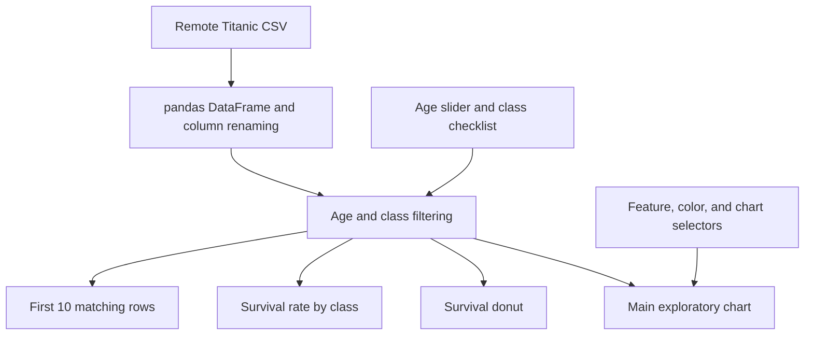

# Titanic Dataset Explorer

### Explore passenger characteristics and survival outcomes through linked interactive views

A **Python dashboard built with Dash, Plotly, pandas, and Dash Bootstrap Components** for exploring Titanic passenger data. Users can change chart types, select variables, and filter passengers by age and class while the survival charts and table update to the same subset.

The project demonstrates exploratory-data interface design: connect data selection, visual comparison, aggregation, and record inspection in one browser application.

[Read the dashboard source](./app.py) · [Dataset used by the application](https://github.com/plotly/datasets/blob/master/titanic.csv)

> **Scope:** Interactive exploratory dashboard. The repository does not contain a trained survival model, statistical hypothesis tests, a written findings report, or saved execution results. The app was reviewed from source and was not launched for this documentation.

---

## The analytical workflow

A chart is most useful when readers can inspect the population behind it. This dashboard combines:

1. **Subset selection:** Age range and passenger class.
2. **Visual exploration:** Scatter, box, violin, or histogram views.
3. **Outcome summaries:** Survival distribution and survival rate by class.
4. **Record inspection:** A preview of matching passenger rows.

This supports questions such as how fare distributions differ across selected classes or how observed survival rates change when exploring different age groups. Those are questions the interface enables; the repository does not establish causal explanations for the patterns.

## Implemented features

| Feature | What users can do |
|---|---|
| X/Y feature selectors | Choose among age, fare, class, sex, survival, and embarkation code |
| Color selector | Encode sex, class, survival, embarkation code, or no color variable |
| Chart selector | Switch between scatter, box, violin, and histogram |
| Age slider | Select an inclusive range from 0 to 80 years |
| Class checklist | Include selected passenger classes |
| Survival donut | View survival counts within the selected subset |
| Class survival bar chart | Compare mean binary survival by class within that subset |
| Table preview | Inspect the first ten matching records and six selected fields |

The main chart uses a 500-millisecond transition setting. Scatter plots include passenger details in hover data. These are interactive chart updates, not a live incoming-data feed.

## Data and preparation

At startup, `app.py` reads a CSV from Plotly's public dataset repository using `pd.read_csv`.

The application renames source columns to lowercase application names, including:

| Source field | Application field |
|---|---|
| `Pclass` | `class` |
| `Sex` | `sex` |
| `Age` | `age` |
| `Survived` | `survived` |
| `Fare` | `fare` |
| `Name` | `name` |
| `Embarked` | `embark_town` |

`Embarked` contains codes in the source CSV; renaming it to `embark_town` does not decode those values into town names. The app does not otherwise impute missing values, remove outliers, or engineer features.

The CSV is downloaded at runtime rather than committed or pinned to a dataset revision. Startup therefore depends on network access and the upstream file remaining available and compatible.

## Linked-view architecture



Four callbacks repeat the same age/class filter for their own output. A fifth callback displays the selected age range. Feature and chart controls affect the main graph; age and class controls affect all data views.

### Shared subset logic

Each data-view callback selects rows with:

```python
(df['age'] >= age_range[0]) & 
(df['age'] <= age_range[1]) & 
(df['class'].isin(class_filter))
```

This keeps the views conceptually aligned. Extracting the repeated logic into a shared function would make future changes easier to maintain.

## How to interpret the survival charts

The donut counts `survived` values and labels them as `Survived` or `Did Not Survive`. The class bar chart groups the filtered rows by class and takes the mean of the binary survival column, then formats the axis as percentages.

Those percentages use **the currently selected subset as their denominator**.

Most importantly, comparisons against missing `age` values are false, so passengers without a recorded age are excluded from every view—even at the default 0–80 range. The default dashboard is therefore not an unfiltered full-dataset summary.

The app does not display the excluded-row count, missingness profile, group sample sizes, or uncertainty intervals. Small selected groups may yield unstable descriptive rates. Associations visible in these charts do not establish that class, age, or fare caused a survival outcome.

## Main-chart behavior

- **Scatter:** Uses selected X and Y variables, color, and detailed hover fields.
- **Box:** Compares the selected Y distribution across X groups.
- **Violin:** Adds a distribution shape and embedded box plot.
- **Histogram:** Uses X and color with a marginal box plot; the selected Y variable is ignored.

All selectors offer the same feature set without checking whether a combination is analytically appropriate. Numeric and categorical encodings may therefore produce less useful combinations. Numeric class and survival values can also be interpreted as continuous color values unless explicitly converted.

## Table behavior

The table displays `name`, `age`, `sex`, `class`, `fare`, and `survived` for the first ten matching rows in source order. It is a preview, not a complete paginated or searchable table. There is no export control or filtered-population count.

## Development setup

The repository contains `app.py` and `README.md`. There is no committed `requirements.txt`, dependency lockfile, test suite, or tested Python-version configuration.

```bash
git clone https://github.com/FaiazS/EDA-on-Titanic-Dataset.git
cd EDA-on-Titanic-Dataset
python -m venv .venv
```

Activate the environment for your operating system, then install the imported third-party packages:

```bash
python -m pip install dash dash-bootstrap-components plotly pandas numpy
python app.py
```

The intended local address is `http://127.0.0.1:8050/`. These commands describe the source's intended development path; the environment was not installed and the application was not executed for this README. Establish compatible versions before relying on a reproducible run.

The source exposes `server = app.server`, which can support later WSGI deployment configuration. No deployment configuration is included, and the entry point currently uses debug mode.

## Reliability and analytical boundaries

- The remote CSV is loaded during module import, with no download error handling, local cache, or schema validation.
- The age slider is fixed to 0–80 instead of derived from the observed data range.
- Missing-age rows are excluded without an explicit user choice.
- Empty class selections and empty subsets have no dedicated explanatory state.
- The survival-count formatting expects a pandas output column named `count`; dependency versions are not pinned.
- No statistical significance, uncertainty, causal inference, or predictive performance is calculated.
- The existing README preview image is a placeholder, not a captured application screenshot.
- No measured findings or numerical performance claims are inferred from the source alone.

## Repository layout

```text
EDA-on-Titanic-Dataset/
├── app.py       # Data loading, layout, filtering, charts, and callbacks
└── README.md
```

## Useful next steps

1. **Make missingness visible:** Show total, selected, and excluded passengers and offer an explicit missing-age policy.
2. **Improve analytical context:** Add group counts, clear category labels, and explanations of survival-rate denominators.
3. **Validate chart combinations:** Restrict or explain unsuitable numeric/categorical pairings and disable Y when unused.
4. **Handle empty selections:** Return clear messages rather than unexplained empty plots.
5. **Make data reproducible:** Pin or cache the dataset and record its schema and source revision.
6. **Improve inspection:** Add pagination, sorting, and an optional subset export.
7. **Document actual findings:** Record reproducible descriptive results, missing-data assumptions, and limitations after running the analysis.
8. **Package and verify:** Add pinned dependencies and focused checks for filtering and aggregation when extending the project.

These are proposed improvements, not implemented functionality.

## Skills demonstrated

**Python · pandas filtering and aggregation · Plotly visualization · Dash callbacks · Interactive exploratory analysis · Bootstrap layout · Linked-view dashboard design**

The strongest portfolio contribution is turning a dataset into an interactive analytical workflow, with the same subset feeding visual and tabular views. Making missing-data treatment and population counts explicit would strengthen the trustworthiness of the exploration.

---

**Author:** [Faiaz Ahmed](https://www.linkedin.com/in/faiazahmed22/) · [GitHub](https://github.com/FaiazS)
